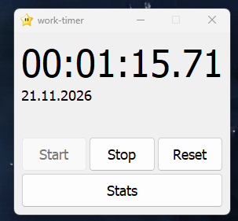
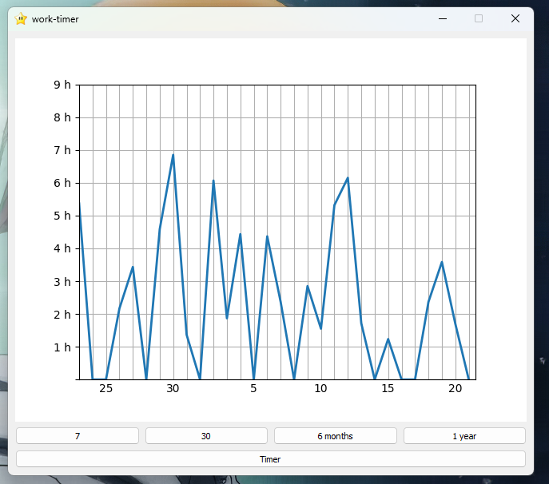

## Screenshots

### Timer


### Statistics


*Screenshots use generated demo data.*


# Work Timer

A simple desktop application for tracking daily work time and visualizing progress over time. Built with Python and PyQt5, it stores time logs locally in SQLite and displays work history using Matplotlib.

## Features

- **Daily time tracking:** Start, stop, and reset a timer that accumulates work time for the current day.
- **Automatic saving:** Work time is saved to a local SQLite database and restored when the application is reopened.
- **Date rollover:** The timer automatically starts tracking a new day when the date changes.
- **Work statistics:** View daily work time over the past 7 days, 30 days, 6 months, or 1 year.
- **Adaptive charts:** Graph labels and time scales adjust to the selected period and recorded work time.

## Tech Stack

- **Python** — application logic
- **PyQt5** — desktop user interface and event handling
- **SQLite** — local data persistence
- **pandas** — processing daily time logs
- **Matplotlib and NumPy** — data visualization

## Getting Started

### Prerequisites

- Python 3.11 or 3.12
- pip

### Installation

1. Clone the repository:

   ```bash
   git clone https://github.com/SamuelRauste/work-timer.git
   cd work-timer
   ```

2. Create and activate a virtual environment:

   ```bash
   python -m venv .venv
   ```

   On Windows:

   ```powershell
   .venv\Scripts\activate
   ```

   On macOS or Linux:

   ```bash
   source .venv/bin/activate
   ```

3. Install the dependencies:

   ```bash
   pip install -r requirements.txt
   ```

4. Run the application:

   ```bash
   python main.py
   ```

## How It Works

The application has two views: a timer and a statistics dashboard. A `QStackedLayout` switches between them, while Qt signals connect timer updates to the statistics view.

Daily totals are stored in `work_timer.db`, with one record per date. The application saves the current total periodically and when the timer is stopped or reset. The statistics view uses pandas to organize the logs into a continuous daily timeline and Matplotlib to display them as a line chart.

## Project Structure

```text
work-timer/
├── main.py                 # Application entry point
├── view_controller.py      # Navigation between views
├── db.py                   # SQLite database operations
├── views/
│   ├── work_timer_view.py  # Timer interface and logic
│   └── stats_view.py       # Statistics and charts
├── requirements.txt        # Python dependencies
└── favicon.ico             # Application icon
```

The database file is created automatically in the working directory and is excluded from version control.
